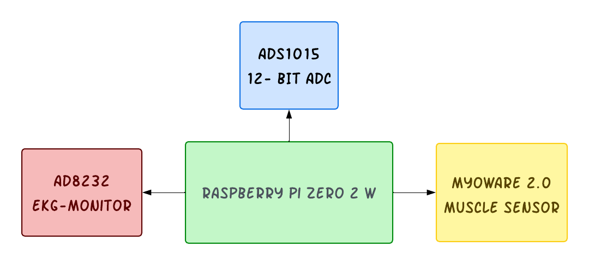
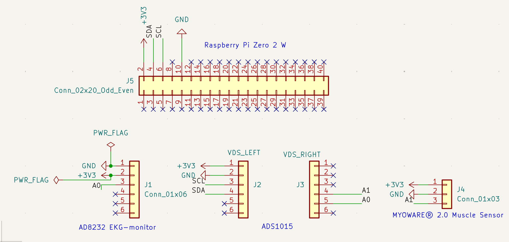
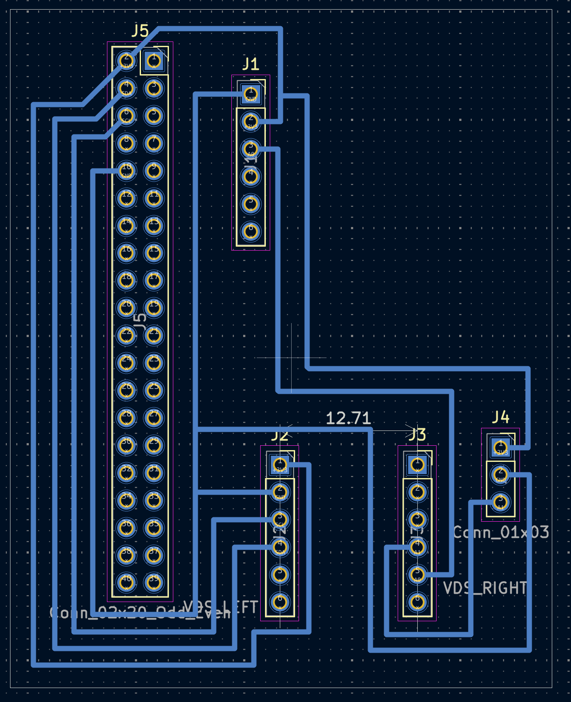
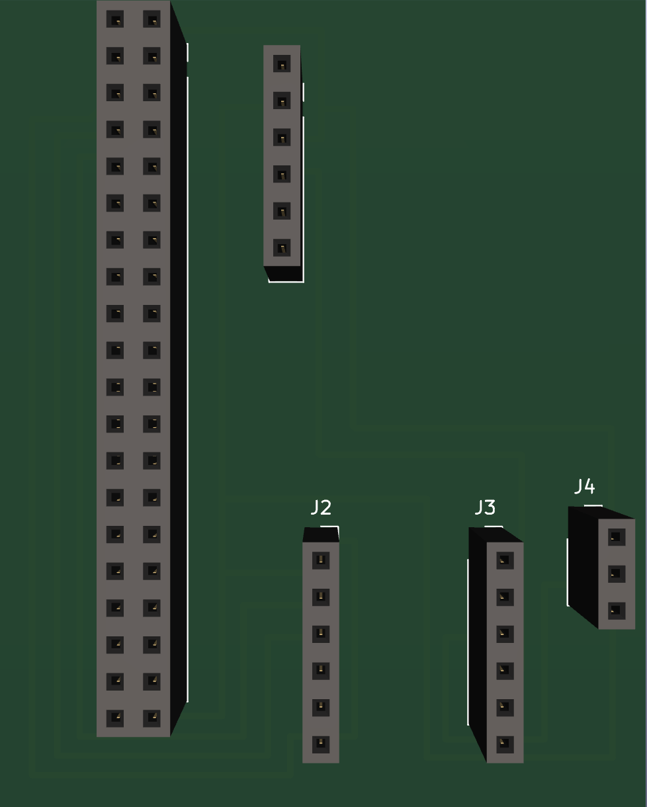
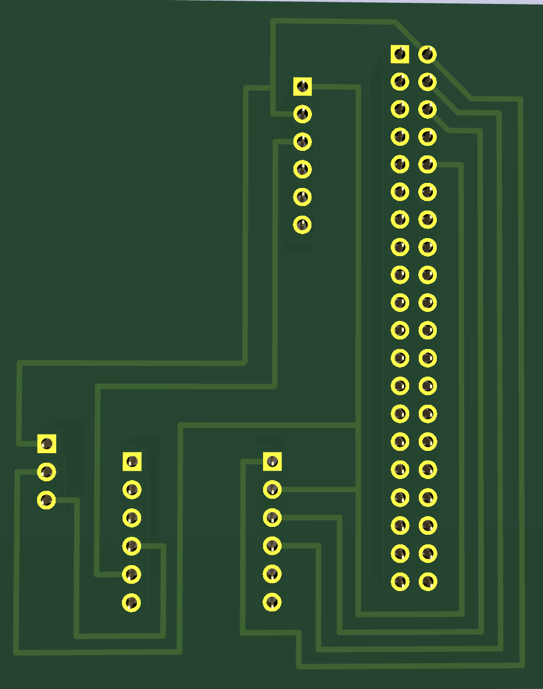
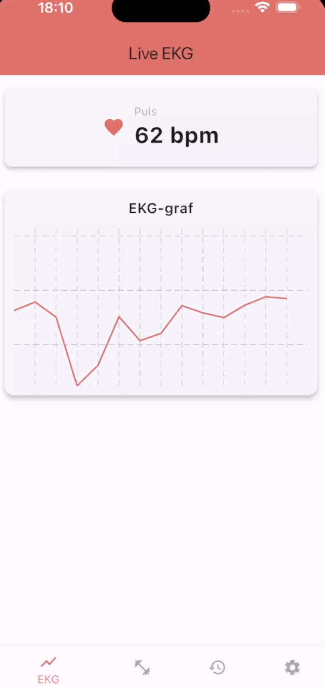
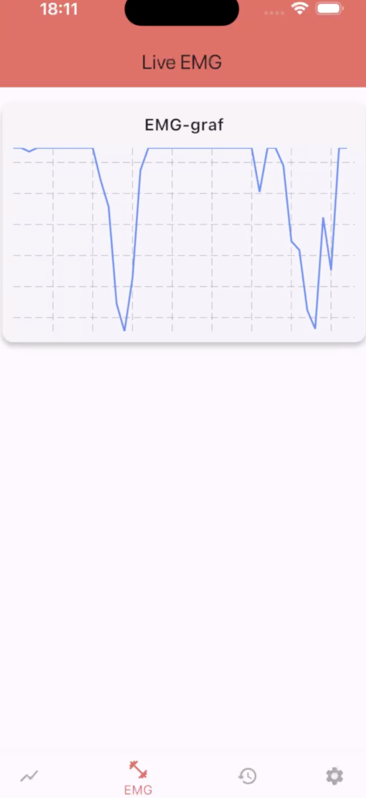

# PulsoSphere: Bärbart EKG- & EMG-mätsystem

Ett integrerat, bärbart mätsystem för samtidig realtidsinsamling och visualisering av elektrokardiografi (EKG) och elektromyografi (EMG). Utvecklat som ett 9 HP ingenjörsprojekt inom kursen CM1002 (Projektkurs inom elektroteknik, del 2) vid Kungliga Tekniska Högskolan (KTH).

Projektet omfattar hela kedjan från egen hårdvarukonstruktion och PCB-tillverkning till digital signalbehandling på inbyggd Linux, REST-API och mobilapplikation.

Utvecklat av Farhad Jelve, Dennis Vidmant, Karib Kaykobad, Muse Dubet och Peter Karlström under handledning av Martin Jakobsson vid KTH.

Viktig notis: Detta är ett akademiskt ingenjörs- och forskningsprojekt och är inte avsett för medicinsk diagnostik eller kliniskt bruk.

---

## Systemöversikt

Systemet samlar in biosignaler från kroppen, digitaliserar och filtrerar signalerna i realtid på en enkortsdator, och strömmar mätdata trådlöst till en mobilapp.



### Signalväg och arkitektur:
1. Analoga sensorer: AD8232 extraherar hjärtsignaler (EKG) och MyoWare 2.0 mäter muskelaktivitet (EMG).
2. A/D-omvandling: Signalerna digitaliseras via Texas Instruments ADS1015 (12-bitars ADC) över I2C-bussen.
3. Centralenhet: Raspberry Pi Zero 2 W (ARM Cortex-A53) kör digital realtidsfiltrering och R-toppsdetektering i Python.
4. Nätverksöverföring: Trådlösa JSON-anrop via Wi-Fi (HTTP POST) till ett REST-API.
5. Backend: Flask med MySQL/MariaDB connection pool lagrar tidsserier och BPM-värden.
6. Mobilapp: Flutter-applikation med Provider state-management och fl_chart för livegrafer.

---

## Hårdvarukonstruktion & PCB-design

För att eliminera kabeltrassel och skapa en kompakt, testvänlig prototyp konstruerades ett skräddarsytt kretskort (PCB) i KiCad.

### 1. Kopplingsschema (Schematic)
Kretskortet designades med standard pin-headers för att modulärt ansluta Raspberry Pi Zero 2 W:s 40-poliga GPIO-header, ADS1015 ADC-kortet, AD8232 och MyoWare 2.0.



- Spänningsmatning: +3.3 V och gemensam jord (GND) distribueras från Raspberry Pi.
- I2C-kommunikation: SDA och SCL ansluts till ADS1015.
- Analoga ingångar: EKG leds till kanal A0 och EMG till kanal A1 på ADS1015.

### 2. Layout & Routing (B.Cu)
Samtliga ledarbanor routades manuellt på kretskortets undersida (Bottom Copper, B.Cu) för att frigöra ovansidan för komponentmontering och undvika korsande signaler.



### 3. Fysisk 3D-modell & Tillverkning
Kortet exporterades till Gerber- och borrfiler (drill files) och tillverkades fysiskt i PCB-fräsen i Makerspace vid KTH Flemingsberg.

| Översida (Komponentmontering) | Undersida (Ledarbanor) |
| :---: | :---: |
|  |  |

---

## Digital Signalbehandling (Python & SciPy)

Biosignaler från kroppen är mycket svaga och känsliga för rörelseartefakter och 50 Hz nätbrum. All signalbehandling sker i realtid på Raspberry Pi Zero 2 W i `PI_Kod/RP.py`.

### 1. Butterworth Bandpassfilter
Ett 4:e ordningens digitalt Butterworth-bandpassfilter (0,25–10 Hz) implementerades med SciPy för att isolera hjärtfrekvensbandet och dämpa högfrekvent muskelbrus:

```python
from scipy.signal import butter, lfilter
import numpy as np

nyq = 20  # Nyquist-frekvens
low = 0.005
high = 0.2
order = 4

b, a = butter(order, [low, high], btype='band')
zi = np.zeros(max(len(a), len(b)) - 1)

# I mätslingan filtreras ett värde i taget i strömmande läge:
y, zi = lfilter(b, a, [voltage], zi=zi)
y = y[0]
```

### 2. Tvåtröskel R-toppsdetektering
Hjärtslag detekteras via en adaptiv tröskelalgoritm:
- Spänningsdifferensen `Δy = y - y_last` kontrolleras mot ett intervall (0.2 V till 0.6 V).
- En refraktärperiod på minst 0.2 sekunder krävs mellan slag för att förhindra dubbelräkning av T-vågor.
- Hjärtfrekvensen (BPM) beräknas kontinuerligt från tidsdifferensen mellan registrerade R-toppar.

---

## Mobilapplikation (Flutter)

Mobilappen är byggd i Flutter och kommunicerar asynkront med Flask-backend via HTTP-polling var 3:e sekund.

| Live EKG-vy (Puls 62 BPM) | Live EMG-vy (Muskelaktivering) |
| :---: | :---: |
|  |  |

### Appens arkitektur:
- **fl_chart:** Vektoriserade realtidsgrafer som buffrar de senaste 100 datapunkterna.
- **Provider:** Dependency injection och state-management för datakontroller, historik och temahantering.
- **TweenAnimationBuilder:** Mjuka övergångar mellan uppdaterade pulsvärden.

---

## Projektstruktur

```text
PulsoSphere/
├── API/
│   └── api.py              # Flask REST-API med MySQL/MariaDB connection pool
├── APP/
│   └── our_flutter_app/    # Flutter mobilapplikation (iOS & Android)
├── PI_Kod/
│   └── RP.py               # Sensorinsamling (I2C) & realtidsfiltrering (SciPy)
├── database/
│   └── db.sql              # Databasschema för tidsserieloggning
├── docs/
│   └── images/             # Scheman, PCB-renderingar och appgrafer
└── README.md
```

---

## Installation & Körning

### 1. Raspberry Pi (Sensornod)
Kräver Raspberry Pi OS med I2C aktiverat:
```bash
sudo raspi-config  # Aktivera Interface Options -> I2C
pip install adafruit-circuitpython-ads1x15 scipy numpy requests
python3 PI_Kod/RP.py
```

### 2. Backend API
```bash
cd API
python3 -m venv .venv
source .venv/bin/activate
pip install flask flask-cors mysql-connector-python
python3 api.py
```

### 3. Flutter Applikation
```bash
cd APP/our_flutter_app
flutter pub get
flutter run
```

---

## Akademisk Referens & Upphovspersoner

Detta projekt genomfördes under vårterminen vid Kungliga Tekniska Högskolan:
- **Kurs:** CM1002 Projektkurs inom elektroteknik, del 2 (9 HP)
- **Handledare:** Martin Jakobsson, KTH
- **PCB-tillverkning:** Linus Remahl, Makerspace KTH Flemingsberg
- **Författare:** Farhad Jelve, Dennis Vidmant, Karib Kaykobad, Muse Dubet, Peter Karlström
